# CountVision — Technical Documentation

**Object-Aware Image Division for Zero-Shot Visual Counting with Vision-Language Models: a reproducibility study of LVLM-Count with Qwen2-VL-7B-Instruct**

---

## Abstract

Large vision-language models (LVLMs) answer counting questions fluently but unreliably, particularly when many small instances are present. LVLM-Count (Qharabagh, Ghofrani and Fountoulakis, 2024) is a training-free wrapper that addresses this weakness by dividing an image into regions that contain fewer objects, counting each region with the LVLM, and summing the regional counts. Its distinguishing step is *object-aware* division: cut lines are routed around detected object masks so that no target object is sliced in two. **CountVision** is an independent reimplementation and evaluation of this method with a single open backbone, **Qwen2-VL-7B-Instruct**, using Grounding DINO (Swin-B) for localisation and the Segment Anything Model (SAM, ViT-H) for segmentation.

The study evaluates the complete method against whole-image counting and ten simpler variants on **FSC-147** (1,190 test images), **Pascal VOC 2007** (102 counting questions), the **Emoji benchmark** (415 questions on 82 images), **Penguin** (100 sampled images, 96 complete cases), and a baseline-only **Synthetic Circles** set (220 images). With paired, trial-averaged predictions, the full method lowers the mean absolute error (MAE) relative to whole-image counting on all four comparison benchmarks: from 35.72 to 30.66 on FSC-147, 6.69 to 5.23 on Pascal VOC 2007, 37.85 to 27.61 on the Emoji benchmark, and 31.12 to 20.95 on the Penguin complete cases. The 95% bootstrap intervals over source images exclude zero in each case. The evidence is, however, more qualified than these headline numbers suggest: the root-mean-square error *increases* on FSC-147, simple equal-strip division and division without area proposals match or beat the full method on FSC-147 and Penguin, and the reported error depends on a post hoc plausibility rule that neutralises a handful of absurd numeric answers. This document describes the method, the experimental protocol, every result with exact figures, and the limitations that a reader should keep in mind.

**Keywords:** visual counting, vision-language models, training-free inference, object-aware image division, divide-and-conquer, reproducibility.

---

## Contents

1. [Introduction](#1-introduction)
2. [Benchmarks](#2-benchmarks)
3. [Method](#3-method)
4. [Worked Example of Object-Aware Division](#4-worked-example-of-object-aware-division)
5. [Evaluated Variants](#5-evaluated-variants)
6. [Experimental Protocol](#6-experimental-protocol)
7. [Results](#7-results)
8. [Discussion](#8-discussion)
9. [Limitations](#9-limitations)
10. [Known Issue in the Released Code](#10-known-issue-in-the-released-code)
11. [Reproducibility](#11-reproducibility)
12. [Future Work](#12-future-work)
13. [References](#13-references)
- [Appendix A — Configuration](#appendix-a--configuration)
- [Appendix B — Repository Layout](#appendix-b--repository-layout)
- [Appendix C — Figure Index and Regeneration](#appendix-c--figure-index-and-regeneration)

---

## 1. Introduction

### 1.1 Motivation

Counting requires two abilities at once: identifying which objects belong to the requested category, and individuating them so that each is counted exactly once. When a scene contains dozens or hundreds of small, occluded or densely packed instances, an LVLM that processes the whole image at a fixed input resolution tends to underestimate the total. Supervised class-agnostic counters trained on FSC-147 [2] are far more accurate on that benchmark, but they require task-specific training and do not inherit the open-ended question answering ability of an LVLM.

### 1.2 The LVLM-Count idea

LVLM-Count [1] keeps the LVLM frozen and changes only what is shown to it. The method rests on a simple observation: an LVLM counts small numbers of objects well, so a large count can be obtained as the sum of several small counts, *provided that the image is divided without cutting objects in half*. A naive division into equal strips violates this condition whenever a strip boundary happens to cross an object, producing double-counting or missed counts. The method therefore:

1. **localises** the target category with an open-vocabulary detector,
2. **segments** every detected instance,
3. **cuts** the image along paths that avoid the segmentation masks, and
4. **counts** each resulting region with the LVLM and sums the results.

### 1.3 Scope of this study

CountVision reimplements this pipeline and evaluates it on one open backbone. It addresses three questions:

- **Q1.** Does the full method reduce counting error relative to asking the LVLM about the whole image?
- **Q2.** Which components (area proposals, mask-aware cuts, the number of regions) account for any improvement?
- **Q3.** How sensitive are the conclusions to practical details such as answer parsing, decoding, and handling of implausible answers?

> **Scope note.** The study uses a single backbone (Qwen2-VL-7B-Instruct, fp16) with near-greedy decoding. It does **not** reproduce the original paper's backbones (GPT-4o, Gemma 3, Qwen2-VL-72B-AWQ), and absolute numbers are therefore not comparable with the paper's tables (see Section 7.7).

---

## 2. Benchmarks

| Benchmark (original name) | Source | Size used here | Notes |
|---|---|---|---|
| **FSC-147** (Few-Shot Counting-147) | Ranjan et al., *Learning To Count Everything*, CVPR 2021 [2] | 1,190 test images | Point-annotated counts for 147 object categories. A 100-image validation subset was used for pilots; a 30-image validation subset was used to tune mask filters. |
| **Pascal VOC 2007** | Everingham et al., PASCAL VOC Challenge [6]; counting questions released by the LVLM-Count authors [1] | 102 questions (5 with true count 0) | The authors' manually corrected question list is the primary benchmark. Only 43 of the 102 released labels agree with the raw VOC count when "difficult" objects are included (28 when they are excluded), and no independent visual adjudication was performed. |
| **Emoji benchmark** | Released with LVLM-Count [1] | 415 questions on 82 images | Target counts range from 30 to 50. Questions about the same image are treated as one cluster in the bootstrap. |
| **Penguin** | Arteta, Lempitsky and Zisserman, *Counting in the Wild*, ECCV 2016 [7] (Penguin Watch) | 100 sampled images; 96 complete cases | Sampled from labelled separate-site test records with probability inversely proportional to the frequency of the ground-truth count (seed 1234); ground truth is the maximum over annotators. The sample spans counts 0–196. |
| **Synthetic Circles** | Generated by `scripts/make_synthetic.py` | 220 images | 20 images for each N ∈ {5, 10, 15, 20, 30, 40, 50, 75, 100, 150, 200}. **Baseline only**: no division variant was run on it. |

The repository does not redistribute any benchmark images, model weights or trial logs.

---

## 3. Method

### 3.1 Pipeline overview

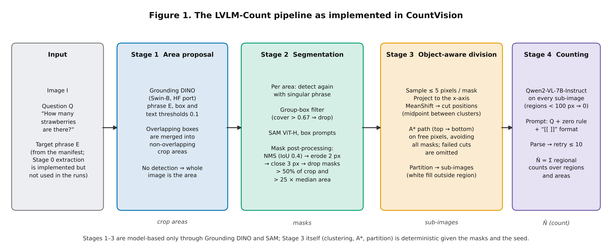

*Figure 1. The LVLM-Count pipeline as implemented in CountVision. Stage 0 (extracting the target phrase from a free-form question) is implemented in the code base, but the evaluated runs use the target phrase supplied in each benchmark manifest.*

The pipeline has four evaluated stages. Given an image *I*, a question *Q* ("How many strawberries are there?") and a target phrase *E* ("strawberries"):

**Stage 1 — Area proposal.** Grounding DINO (Swin-B, Hugging Face port) is run on the whole image with box and text thresholds of 0.1. Overlapping boxes are merged into non-overlapping rectangular *areas*. If nothing is detected, the whole image is the single area.

**Stage 2 — Segmentation.** Inside each area, Grounding DINO is queried again with the singularised phrase. A *group-box filter* removes boxes that enclose many smaller boxes. The remaining boxes prompt SAM ViT-H to produce one mask each, and the masks are post-processed (Section 3.2).

**Stage 3 — Object-aware division.** Pixels sampled from the masks are projected onto the horizontal axis and clustered; a vertical cut is proposed between adjacent clusters; and an A\* search finds a top-to-bottom path through the free (mask-free) pixels at each proposed cut. The image is partitioned along the found paths (Section 3.3).

**Stage 4 — Counting.** Each region becomes a sub-image (original pixels inside the region, white elsewhere). The LVLM is prompted on each sub-image and the answers are summed over regions and areas:

$$\hat N \;=\; \sum_{a \in \text{areas}} \; \sum_{r \in \text{regions}(a)} f_{\text{LVLM}}(r, Q), \qquad f_{\text{LVLM}}(r, Q)=0 \ \text{ if } |r| < 100 \text{ px}.$$

### 3.2 Mask post-processing and the group-box filter

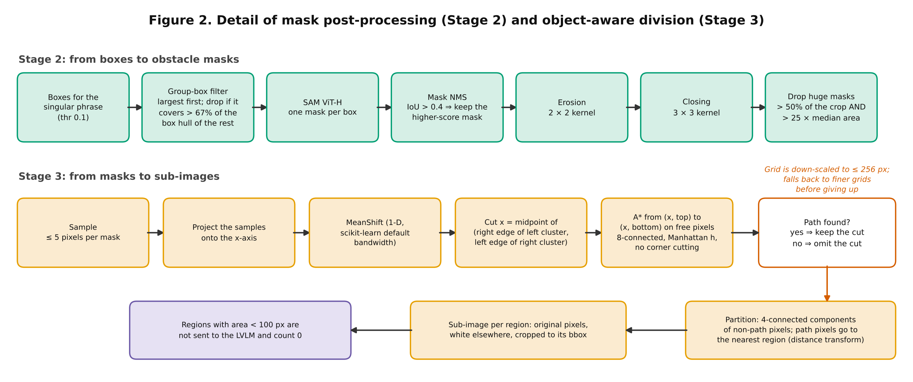

*Figure 2. Detail of Stage 2 (boxes to obstacle masks, top) and Stage 3 (masks to sub-images, bottom).*

The segmentation stage is the part of the method that most affects whether a cut is possible, because every retained mask acts as an obstacle for the path search. Post-processing therefore aims to remove spurious or oversized masks.

| Step | Setting | Purpose |
|---|---|---|
| Group-box filter | Boxes sorted largest first; a box is dropped if it covers more than 67% of the bounding hull of all smaller boxes | Removes "group" boxes that would produce one giant mask |
| Mask NMS | IoU > 0.4 ⇒ keep the higher-scoring mask | Removes duplicate masks |
| Erosion | 2 × 2 kernel | Opens a small gap between touching objects |
| Closing | 3 × 3 kernel | Fills small holes inside masks |
| Oversize filter | Drop a mask if it exceeds **both** 50% of the crop **and** 25 × the median mask area | Removes background-sized false positives |

The group-box filter and the 25 × median rule are not stated as prominently in the paper's text as the other steps, but they are present in the authors' public code and proved decisive in practice (Section 7.9).

### 3.3 Object-aware division

Division proceeds as follows (vertical cuts only, the main setting):

1. **Sampling.** Up to five pixels are drawn at random from each retained mask (seeded).
2. **Projection and clustering.** The sampled pixels are projected onto the x-axis and grouped with one-dimensional mean shift (scikit-learn default bandwidth).
3. **Cut positions.** For each pair of adjacent clusters, the cut is placed at the midpoint between the right edge of the left cluster and the left edge of the right cluster.
4. **Path search.** An A\* search finds a path from (x, top) to (x, bottom) over free pixels. The grid is 8-connected with unit step cost, diagonal corner-cutting is forbidden (so that a straight segment between consecutive nodes can never touch an obstacle), and the heuristic is Manhattan distance. For efficiency the grid is down-scaled so that its longer side is at most 256 pixels; a coarse cell is traversable only if *all* of its pixels are free, and finer grids are tried before giving up. If no path exists, the cut is omitted.
5. **Partition.** Path pixels separate the image into regions (4-connected components of non-path pixels). Path pixels are assigned to the nearest region by a distance transform, so that every pixel belongs to exactly one region.
6. **Sub-images.** Each region is rendered as a sub-image, cropped to its bounding box, with white fill outside the region. Regions smaller than 100 pixels are not sent to the LVLM and count as zero.

### 3.4 Counting prompt and answer parsing

Each sub-image is passed to the LVLM with the original question, an instruction to answer zero when no target is visible ("Say 0 if you do not see any."), and a format instruction ("Report your final answer with only one number inside [[Double Brackets]]"). Parsing is applied in this order:

1. **Strict:** a number inside double brackets, `[[n]]`.
2. **Lenient:** a reply that consists only of a number or number word, optionally in single brackets (`[5]`, `5`, `five.`).
3. **Retry:** anything else is re-queried, up to ten attempts.

The lenient rule is applied identically to the baseline and to every variant. It was introduced because a pilot showed that Qwen2-VL-7B frequently ignores the double-bracket format (Section 7.8).

---

## 4. Worked Example of Object-Aware Division

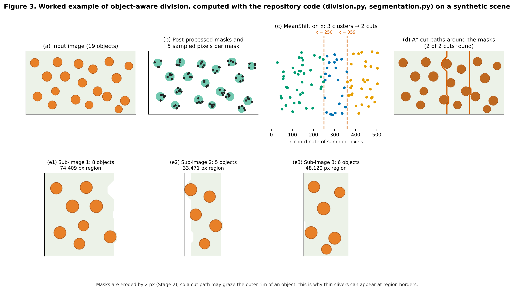

*Figure 3. Worked example computed with the repository's own `division.py` and `segmentation.py` on a synthetic scene of 19 objects. (a) Input. (b) Post-processed masks with five sampled pixels per mask. (c) Mean shift on the x-coordinates finds three clusters and therefore two cuts, at x = 250 and x = 359. (d) A\* routes each cut around the masks. (e) The three resulting sub-images contain 8, 5 and 6 objects (sum 19).*

The scene is synthetic and was chosen to be illustrative; it is **not** drawn from any benchmark, and the figure is not evidence of performance. Because masks are eroded by 2 px before the search, a path may graze the outer rim of an object, which is why thin slivers of an object can be visible at a region border.

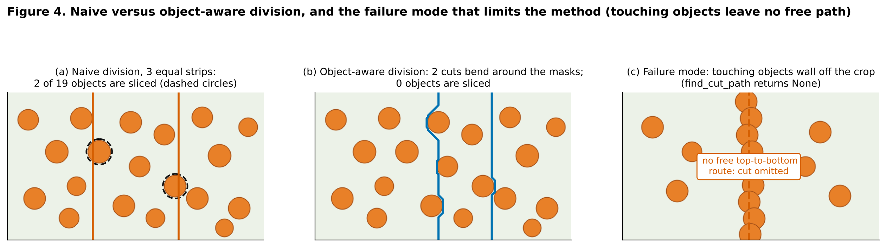

*Figure 4. (a) Three equal strips slice 2 of the 19 objects. (b) Object-aware cuts bend around the masks and slice none. (c) The failure mode: when objects touch and form a wall across the crop, no free top-to-bottom path exists and the cut is omitted.*

Panel (c) is the method's principal limitation. A cut that cannot be drawn is simply dropped, so the image is divided less than intended. Section 7.9 quantifies how often this happens on real images.

---

## 5. Evaluated Variants

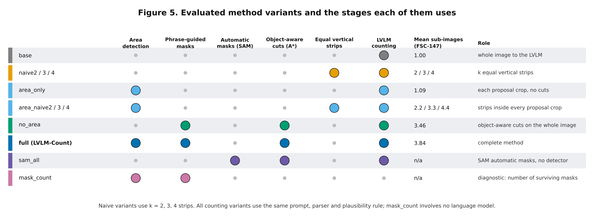

*Figure 5. The evaluated variants and the components each uses. "Mean sub-images" is the average number of regions per FSC-147 image. All counting variants share the same prompt, parser and plausibility rule.*

| Variant | Description |
|---|---|
| `base` | Whole image sent to the LVLM (the reference). |
| `naive2` / `naive3` / `naive4` | The whole image is split into 2, 3 or 4 equal vertical strips. |
| `area_only` | Each Grounding DINO proposal crop is counted without further division. |
| `area_naive2` / `3` / `4` | Equal strips inside every proposal crop. |
| `no_area` | Object-aware division applied to the whole image, without area proposals. |
| `full` | The complete LVLM-Count method (area proposals + object-aware division). |
| `sam_all` | Object-aware division using SAM automatic masks, with no phrase-guided detection (Penguin only). |
| `mask_count` | **Diagnostic, no LVLM:** the prediction is the number of surviving masks. |

---

## 6. Experimental Protocol

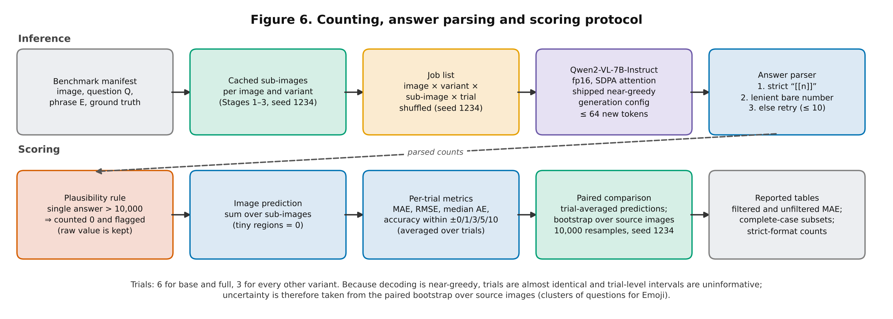

*Figure 6. Counting, answer parsing and scoring protocol.*

### 6.1 Model and decoding

All counts come from **Qwen2-VL-7B-Instruct** [3] in fp16 with scaled-dot-product attention, using the model's shipped generation configuration (sampling enabled with temperature 0.01, top-p 0.001, top-k 1, i.e. near-greedy) and at most 64 new tokens. Hardware was six Tesla V100 32 GB GPUs, which lack bf16 and FlashAttention-2 support.

A first plan to sample at temperature 1.0 was abandoned. On a 100-image FSC-147 validation pilot with three trials, the near-greedy configuration gave MAE of 44.2 (base), 36.2 (full) and 43.4 (naive3), while temperature 1.0 gave 118.9, 58.5 and 107.9, dominated by outliers. The change was prompted by absurd outputs in a first test-set run and then confirmed on the validation pilot; the discarded temperature-1.0 test results are not reported.

### 6.2 Trials and uncertainty

`base` and `full` use six trials per question; every other variant uses three. Because decoding is near-greedy, trials are almost identical, so trial-level confidence intervals are close to zero and uninformative. Uncertainty is therefore estimated with a **paired bootstrap over source images**: predictions are averaged across trials for each question, the absolute error difference between `base` and `full` is computed per question, and source images are resampled with replacement 10,000 times (seed 1234). For the Emoji benchmark, all questions on one image are kept together (82 clusters).

### 6.3 Metrics

- **MAE** — mean absolute error (primary metric).
- **RMSE** — root-mean-square error; more sensitive to large misses.
- **Median AE** — median absolute error.
- **Accuracy within ±k** for k ∈ {0, 1, 3, 5, 10}.
- **Bias** — mean signed error (negative = undercounting).

Metrics are computed per trial and averaged, except for the paired comparison, which uses trial-averaged predictions. This is why the FSC-147 `base` MAE appears as 35.75 in the per-variant table and 35.72 in the paired analysis.

### 6.4 Plausibility rule

A single LVLM answer greater than **10,000** is treated as invalid: it is counted as 0 and flagged. Raw predictions are retained and every table that depends on the rule also reports unfiltered MAE. **This rule was chosen after inspecting test-set outputs** (22 of 127,278 FSC-147 answers exceeded the bound, for example a repeated answer of 659,135,152). It is applied identically to every variant, and re-asking cannot help because near-greedy decoding reproduces the same answer. It is a post hoc validity rule, and readers should treat the filtered and unfiltered numbers together (Section 7.7 and Figure 13).

---

## 7. Results

### 7.1 Whole-image counting versus the full method

| Benchmark (original name) | n | MAE `base` | MAE `full` | Δ MAE | 95% CI (bootstrap) | Relative reduction |
|---|---|---|---|---|---|---|
| FSC-147 (test) | 1,190 images | 35.72 | 30.66 | 5.06 | [1.83, 8.25] | 14.2% |
| Pascal VOC 2007 | 102 questions | 6.69 | 5.23 | 1.47 | [0.69, 2.25] | 21.9% |
| Emoji benchmark | 415 questions / 82 images | 37.85 | 27.61 | 10.24 | [7.78, 12.67] | 27.1% |
| Penguin (complete cases) | 96 images | 31.12 | 20.95 | 10.18 | [5.79, 14.53] | 32.7% |

*Table 1. Paired MAE of whole-image counting and the full method with Qwen2-VL-7B-Instruct. Δ MAE = MAE(base) − MAE(full); positive values favour the full method. Intervals are percentile intervals from 10,000 bootstrap resamples of source images. The full method has the lower error on 99.9% of resamples for FSC-147 and on 100% for the other three benchmarks.*

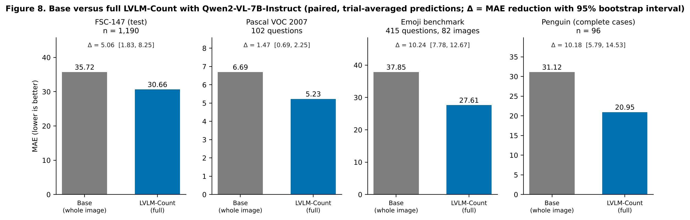

*Figure 8. Base versus full MAE with the paired reduction and its 95% bootstrap interval.*

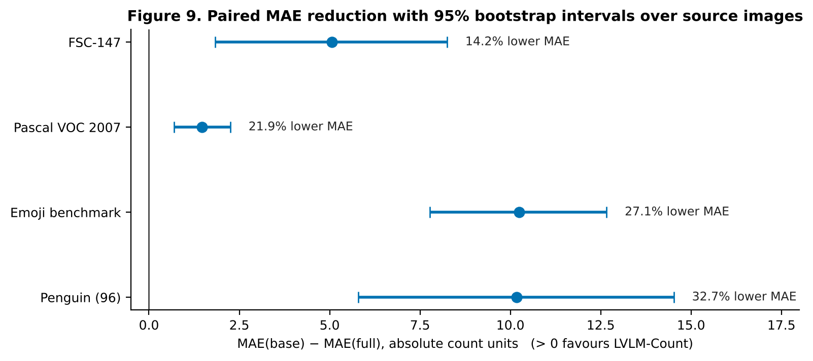

*Figure 9. Paired MAE reductions with 95% bootstrap intervals over source images. All intervals lie to the right of zero.*

The improvement is largest in relative terms on the benchmarks with many objects per image (Emoji benchmark and Penguin) and smallest on FSC-147, whose images mix very sparse and very dense scenes.

### 7.2 Accuracy within a tolerance

| Benchmark | Method | ±0 | ±1 | ±3 | ±5 | ±10 |
|---|---|---|---|---|---|---|
| FSC-147 | base | 10.85 | 22.87 | 37.32 | 45.21 | 56.72 |
| FSC-147 | full | 10.90 | 24.93 | 41.12 | 50.28 | 61.43 |
| Pascal VOC 2007 | base | 24.51 | 41.18 | 54.90 | 62.75 | 76.47 |
| Pascal VOC 2007 | full | 30.23 | 44.12 | 58.82 | 73.53 | 85.29 |
| Emoji benchmark | base | 0.72 | 1.45 | 2.65 | 4.50 | 6.79 |
| Emoji benchmark | full | 1.69 | 4.82 | 7.87 | 13.29 | 21.93 |
| Penguin | base (100 images) | 1.00 | 2.00 | 8.00 | 12.00 | 22.00 |
| Penguin | full (96 images) | 1.04 | 4.17 | 15.28 | 20.49 | 40.62 |

*Table 2. Percentage of questions answered within ±k of the ground truth.*

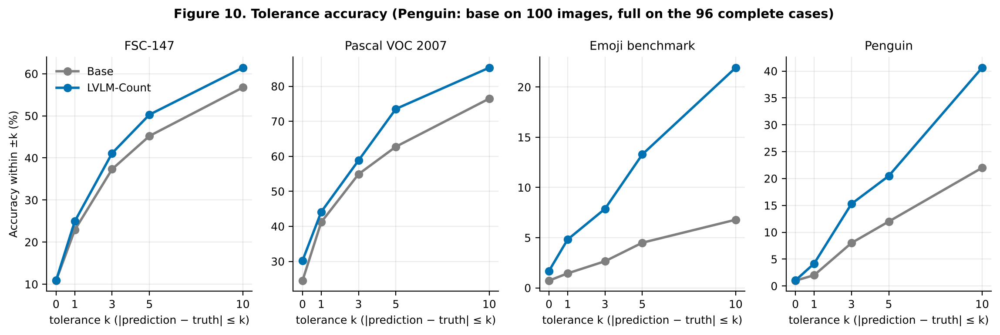

*Figure 10. Tolerance accuracy curves. On FSC-147 the two methods coincide at exact match (about 10.9%) and diverge as the tolerance widens.*

Exact-match accuracy on FSC-147 is essentially unchanged (10.85% versus 10.90%), so the gain there comes from reducing moderate errors rather than from more exact counts. On the Emoji benchmark, where true counts are 30 to 50, exact accuracy remains very low for both methods (0.72% and 1.69%).

### 7.3 Mean, squared and median error

| Benchmark | Metric | `base` | `full` |
|---|---|---|---|
| FSC-147 | MAE | 35.75 | 30.70 |
| FSC-147 | RMSE | 131.74 | **143.50** |
| FSC-147 | Median AE | 7.00 | 5.00 |
| FSC-147 | Bias | −24.85 | −16.00 |
| Pascal VOC 2007 | MAE / RMSE / Median AE | 6.69 / 11.72 / 2.00 | 5.23 / 10.05 / 2.00 |
| Emoji benchmark | MAE / RMSE / Median AE | 37.98 / 41.58 / 38.00 | 27.67 / 34.22 / 27.00 |
| Penguin | MAE / RMSE / Median AE | 32.06 / 40.03 / 27.00 | 21.02 / 28.84 / 16.83 |

*Table 3. Error metrics averaged over trials (per-variant table; `base` Penguin on 100 images, `full` on 96).*

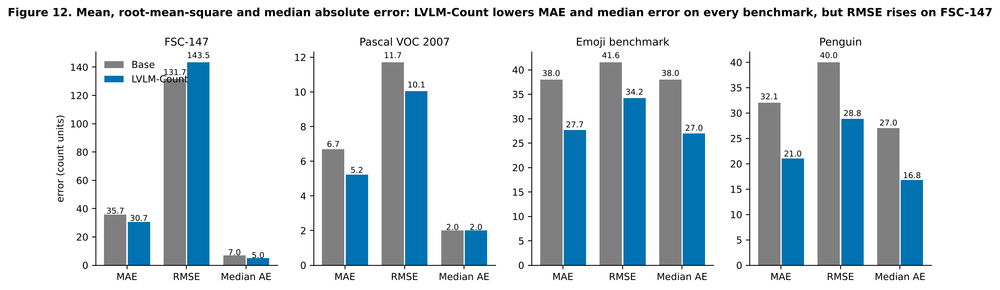

*Figure 12. MAE, RMSE and median absolute error for base and full counting.*

On FSC-147 the full method lowers MAE and median error but **raises RMSE** from 131.74 to 143.50. A few very dense images dominate the squared error, and the method does not repair them; the improvement is concentrated in typical images. All variants remain biased towards undercounting on FSC-147 (the full method's bias is −16.00).

### 7.4 Ablation of division strategies

| Variant | FSC-147 MAE (1,190 images) | Penguin MAE (96 complete cases) | Mean sub-images (FSC-147) |
|---|---|---|---|
| `no_area` | **29.98** | 19.30 | 3.46 |
| `area_naive3` | 30.59 | 20.92 | 3.26 |
| `full` | 30.70 | 21.02 | 3.84 |
| `naive4` | 30.87 | **18.70** | 4.00 |
| `area_naive4` | 31.44 | 25.95 | 4.35 |
| `area_naive2` | 31.72 | 20.72 | 2.18 |
| `naive2` | 31.83 | 20.75 | 2.00 |
| `area_only` | 35.16 | 29.09 | 1.09 |
| `naive3` | 35.16 | 25.95 | 3.00 |
| `base` | 35.75 | 31.12 | 1.00 |
| `sam_all` | not run | 31.30 | not available |
| `mask_count` (no LVLM) | 38.60 | 22.61 | not applicable |

*Table 4. Plausibility-filtered MAE by variant. Penguin values are computed on the 96 images for which every variant produced a result.*

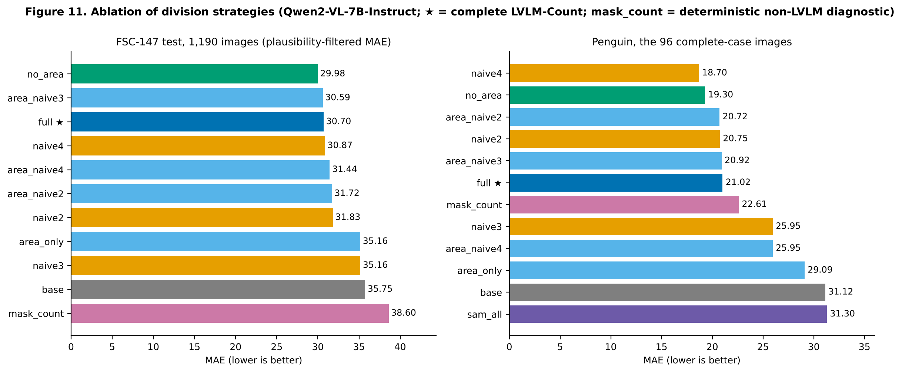

*Figure 11. Ablation of division strategies on FSC-147 (left) and the Penguin complete cases (right). The star marks the complete LVLM-Count method.*

Three observations follow.

1. **Any division helps relative to the whole image**, with the exception of `area_only` and `naive3` on FSC-147, which barely differ from `base` (35.16 versus 35.75).
2. **The full method is not the best variant.** On FSC-147 `no_area` (29.98) and `area_naive3` (30.59) are slightly lower than `full` (30.70), and on Penguin `naive4` (18.70) and `no_area` (19.30) are lower than `full` (21.02). The differences among the top variants on FSC-147 are of the order of 1 MAE unit, and no interval is available for them (the bootstrap was run for base versus full only), so they should not be over-interpreted.
3. **Mask-aware paths are not shown to be the active ingredient.** Equal strips (`naive4`, `area_naive3`) are competitive with object-aware cuts, and `naive3` is no better than `base` on FSC-147 although it uses three regions, which indicates that the number and layout of regions matter in ways these experiments do not isolate.

The deterministic `mask_count` diagnostic is informative about the detection stack. It is worse than whole-image counting on FSC-147 (38.60 versus 35.75), Pascal VOC 2007 (8.02 versus 6.69) and the Emoji benchmark (53.71 versus 37.98), but it is better than `base` on the Penguin complete cases (22.61 versus 31.12) and close to `full` (21.02). On Penguin, then, the detector and segmenter alone count as well as the LVLM wrapper.

### 7.5 Synthetic Circles (baseline only)

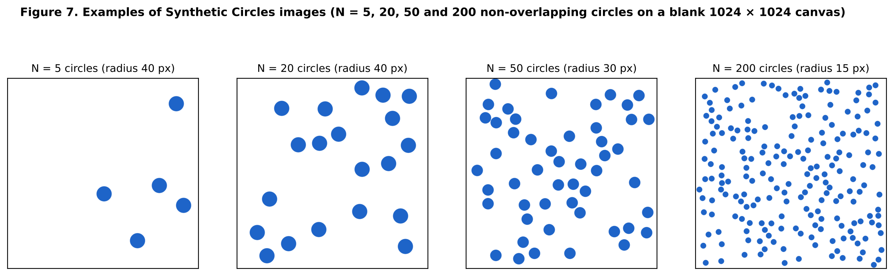

*Figure 7. Examples of Synthetic Circles images with N = 5, 20, 50 and 200 non-overlapping circles on a blank 1024 × 1024 canvas.*

Whole-image counting with Qwen2-VL-7B-Instruct on the 220 Synthetic Circles images gives MAE 16.51, RMSE 41.03, median absolute error 1.00, and bias −9.57. It is exactly correct on 48.33% of images and within ±10 on 73.18%. The large gap between the mean (16.51) and the median (1.00) shows that errors are concentrated in the dense scenes. This experiment is a baseline only; it **cannot** measure the benefit of division because no division variant was run on it.

### 7.6 Which answers are affected by the plausibility rule?

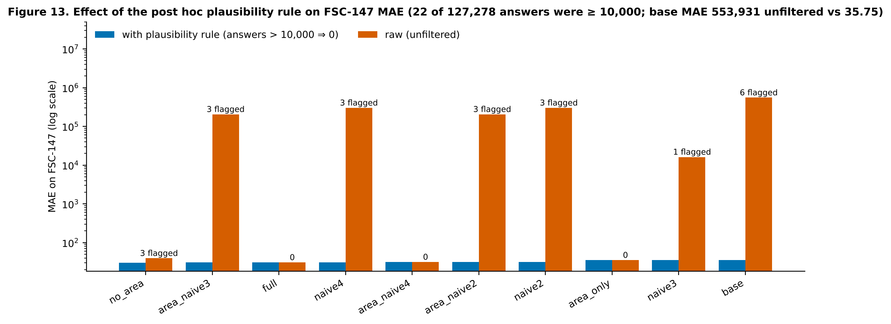

*Figure 13. FSC-147 MAE with and without the plausibility rule (logarithmic scale). Numbers above the orange bars give the count of answers above 10,000.*

Across all variants on FSC-147, 22 of 127,278 answers exceeded the bound. `base` produced six of them, and its unfiltered MAE is 553,931 against 35.75 after filtering. `full`, `area_only` and `area_naive4` produced none. The rule therefore favours the comparison between `base` and `full` only in the sense that it removes the reference's catastrophic answers; the paired difference in Table 1 (5.06 MAE units) is computed after filtering. Because the bound was set after the test outputs were seen, the unfiltered figures should be read alongside the filtered ones.

### 7.7 Comparison with the figures reported in the original paper

| Benchmark | Paper: Qwen2-VL-72B-AWQ base → LVLM-Count (MAE) | Paper relative reduction | This study: Qwen2-VL-7B-Instruct base → full (MAE) | Relative reduction |
|---|---|---|---|---|
| FSC-147 | 34.18 → 22.29 | 34.8% | 35.72 → 30.66 | 14.2% |
| Pascal VOC 2007 | 4.80 → 4.12 | 14.2% | 6.69 → 5.23 | 21.9% |
| Emoji benchmark | 78.05 → 24.43 | 68.7% | 37.85 → 27.61 | 27.1% |
| Penguin | 44.02 → 28.21 | 35.9% | 31.12 → 20.95 | 32.7% |

*Table 5. Figures reported by Qharabagh et al. [1] (transcribed in `results/tables/paper_reported.json`, never used in any computation) next to this study's paired estimates.*

**This table is a context table, not a replication check.** The backbones differ (72B with AWQ quantisation versus 7B in fp16), as do the decoding configuration, the answer-handling rules, and potentially the benchmark subsets. The direction of the effect agrees with the paper on all four benchmarks, but the magnitudes should not be compared. The paper also reports specialist counters on FSC-147 (for example CountGD, MAE 14.76; GroundingREC, MAE 10.12); those figures were copied from the paper rather than re-run, and the 7B LVLM wrapper (30.66) remains far above them.

### 7.8 Answer-format compliance

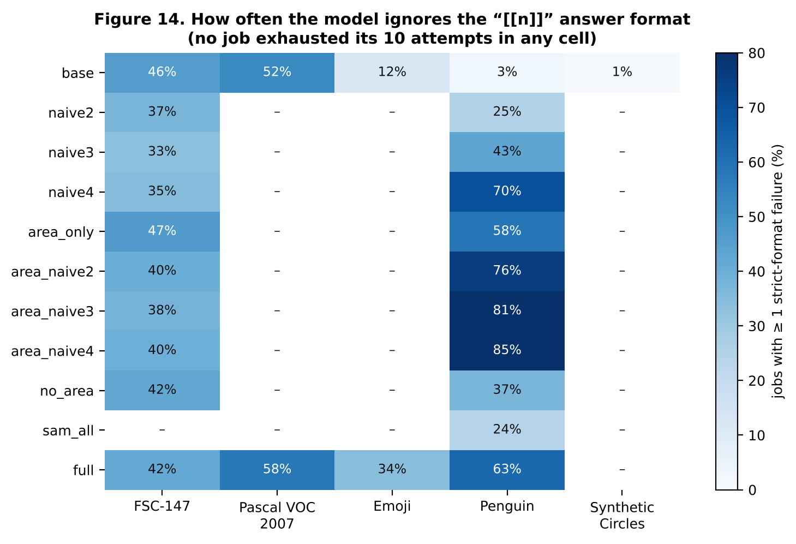

*Figure 14. Percentage of jobs in which the model ignored the strict `[[n]]` format at least once. No job exhausted its ten attempts in any cell.*

| Benchmark | `base` | `full` |
|---|---|---|
| FSC-147 | 46% | 42% |
| Pascal VOC 2007 | 52% | 58% |
| Emoji benchmark | 12% | 34% |
| Penguin | 3% | 63% |
| Synthetic Circles | 1% | not run |

*Table 6. Jobs with at least one strict-format failure.*

Across 141,486 verified jobs, no job exhausted its retries, so every reported prediction comes from a parsed answer. Strict-format failures are nevertheless common, and the lenient parser is therefore an important part of the protocol: without it, a large share of jobs would have required retries or been counted as zero. These figures describe formatting behaviour only and say nothing about semantic accuracy.

### 7.9 How often can a cut actually be drawn?

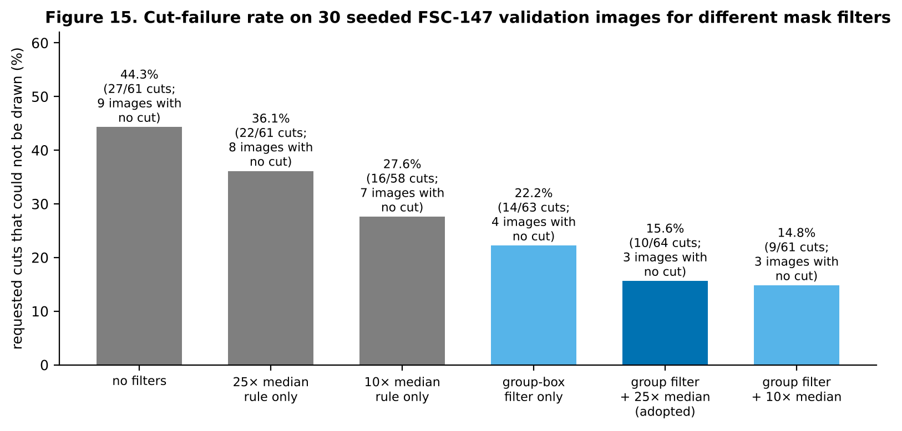

*Figure 15. Cut-failure rate on 30 seeded FSC-147 validation images for different mask filters.*

| Mask filtering | Requested cuts | Failed | Failure rate | Images with no successful cut |
|---|---|---|---|---|
| None | 61 | 27 | 44.3% | 9 |
| 25 × median rule only | 61 | 22 | 36.1% | 8 |
| 10 × median rule only | 58 | 16 | 27.6% | 7 |
| Group-box filter only | 63 | 14 | 22.2% | 4 |
| Group filter + 25 × median (**adopted**) | 64 | 10 | 15.6% | 3 |
| Group filter + 10 × median | 61 | 9 | 14.8% | 3 |

*Table 7. Effect of mask filtering on cut failures (validation images only; test sets untouched).*

Without any filtering, 44.3% of requested cuts cannot be drawn, because a single false-positive mask can wall off the crop. The adopted configuration reduces this to 15.6%. The remaining failures are mostly cases of touching objects with no free gap, which is the limitation stated in the paper. The filters were selected on 30 validation images, so the failure rate on the test sets was not measured.

---

## 8. Discussion

**The effect on average error is consistent in direction.** On every benchmark where both were run, the full method has a lower MAE than whole-image counting and the paired bootstrap interval excludes zero. For a frozen 7B model, this supports the central claim of the original method: dividing the image into smaller regions helps.

**The mechanism is less clear than the headline.** Several simpler variants are as good as or better than the full method, and `naive3` is no better than `base` on FSC-147. The experiments therefore support "dividing helps on average" more strongly than "mask-aware cuts are what help". The deterministic mask count on Penguin (22.61) rivalling the full wrapper (21.02) further suggests that, for that dataset, much of the benefit comes from the detection stack rather than from the LVLM's regional counts.

**The improvement is concentrated in typical errors.** MAE and median error fall on FSC-147, but RMSE rises and exact-match accuracy is unchanged. Users who care about worst-case behaviour on very dense scenes should not infer a benefit from this study.

**Practical protocol details are first-order.** Answer filtering changes the base MAE by more than four orders of magnitude, and format compliance varies from 3% to 63% across benchmarks. Any comparison between counting methods with a small open LVLM should state its parsing and validity rules.

**Cost.** The full method issues several LVLM calls per question (on average 3.84 sub-images per FSC-147 image, 7.16 per Pascal VOC 2007 question, 4.18 per Emoji question, and 6.58 per Penguin image), in addition to Grounding DINO and SAM inference. The saved records contain no comparable latency measurements, so cost is not quantified beyond the call counts.

---

## 9. Limitations

1. **One backbone and one decoding regime.** Only Qwen2-VL-7B-Instruct with near-greedy decoding was evaluated. The additional backbones (Qwen2.5-VL-7B and 32B) and a clean higher-temperature comparison were planned but are not part of the reported results. The paper's backbones were not reproduced.
2. **Post hoc plausibility rule.** The 10,000 bound was selected after observing test outputs. It is applied uniformly and unfiltered values are reported, but it remains a choice made with knowledge of the test data.
3. **Tuning on validation data.** The group-box filter and 25 × median rule were chosen using 30 FSC-147 validation images, and the near-greedy decoding choice was confirmed on a 100-image validation pilot after a first test-set run exposed absurd outputs.
4. **Incomplete Penguin coverage.** Four Penguin images failed in the full pipeline's preprocessing (logs attribute this to CUDA allocation errors), and two of them also failed for `no_area`. Complete-case comparisons control the denominator, but behaviour on the omitted images is unknown.
5. **Unaudited Pascal labels.** Only 43 of the 102 released Pascal VOC 2007 labels equal the raw VOC count, and no independent visual adjudication was carried out.
6. **No ablation on Synthetic Circles, and no intervals for ablations.** Division variants were not run on Synthetic Circles, and the bootstrap was applied to the base-versus-full contrast only. Differences among the top variants cannot be called significant or insignificant on this evidence.
7. **No latency measurement and no re-run specialists.** Cost is expressed only as the number of sub-images, and specialist counters are quoted from the paper.
8. **Failure rate of cuts on test data is unmeasured.** Cut failure was diagnosed on validation images only.
9. **Illustrative figures.** Figures 3, 4 and 7 are computed with the repository's code on synthetic scenes (or a generator that mirrors `make_synthetic.py`) and illustrate the algorithm; they are not benchmark results.

---

## 10. Known Issue in the Released Code

`LVLMCount.run()` in `src/lvlm_count/pipeline.py` reads `cfg["counting"]["max_retries"]`, but `cfg` is not defined in that method (it is defined only inside `divide()`). Calling `run()` directly therefore raises `NameError: name 'cfg' is not defined`. The one-line fix is to use `self.cfg["counting"]["max_retries"]`.

The reported results are not affected: the evaluation scripts cache the output of `divide()` (Stages 1–3) and perform counting separately through the job-based worker, so `run()` is not on the evaluated code path. The figure script in this documentation package uses `divide`-level functions only. The defect was reproduced with a mock LVLM on a blank image: `divide()` succeeds and `run()` raises the error.

---

## 11. Reproducibility

### 11.1 What can be run without a GPU

```sh
python3 -m venv .venv && source .venv/bin/activate
python -m pip install -r requirements.txt
make test-cpu PY_PAPER=python          # division and parser/metric unit tests
make paper PY_PAPER=python             # rebuilds the PDF report from checked-in CSVs
python scripts/figures/doc_figures.py  # regenerates every figure in this document
```

The full test suite (59 tests) passes when run with `PYTHONPATH=src`. The report and figures build from the checked-in tables in `results/tables/`; no model weights, datasets or raw predictions are needed.

### 11.2 What requires GPUs and external assets

The `make` targets `benchmarks`, `precompute`, `jobs`, `run` and `aggregate` rebuild the benchmark manifests, cache Stages 1–3, and run Qwen2-VL-7B-Instruct. They require the datasets and model checkpoints in the sibling directories expected by `configs/lvlm_count.yaml`, two environments (detector stack with transformers 4.47.1 and LVLM stack with transformers 4.57, recorded in `requirements.detect.lock` and `requirements.lvlm.lock`), and GPU wheels from a compatible PyTorch index. All randomness is seeded with 1234.

### 11.3 Rights and citation

The repository's `LICENSE` states that all rights are reserved by the respective copyright holders and that **no open-source licence has been assigned**. `CITATION.cff` asks users to cite both this software and the original LVLM-Count paper.

---

## 12. Future Work

- Evaluate additional backbones (Qwen2.5-VL, and the paper's GPT-4o and Gemma 3) and a clean temperature sensitivity study.
- Extend the bootstrap to the full ablation grid, and run the division variants on Synthetic Circles to test how benefit scales with object count.
- Complete Penguin inference on the missing records, and audit the Pascal VOC 2007 labels visually.
- Measure latency and call counts per method so that accuracy can be reported against cost.
- Fix the `run()` defect and add an end-to-end CPU test using the mock LVLM.
- Study horizontal and combined cuts, and alternatives to omitting failed cuts, such as relaxing the mask filters adaptively.

---

## 13. References

1. M. F. Qharabagh, M. Ghofrani and K. Fountoulakis. *LVLM-Count: Enhancing the Counting Ability of Large Vision-Language Models.* arXiv:2412.00686, 2024.
2. V. Ranjan, U. Sharma, T. Nguyen and M. Hoai. *Learning To Count Everything.* CVPR, 2021. (FSC-147)
3. P. Wang et al. *Qwen2-VL: Enhancing Vision-Language Model's Perception of the World at Any Resolution.* arXiv:2409.12191, 2024.
4. S. Liu et al. *Grounding DINO: Marrying DINO with Grounded Pre-Training for Open-Set Object Detection.* ECCV, 2024.
5. A. Kirillov et al. *Segment Anything.* ICCV, 2023.
6. M. Everingham et al. *The PASCAL Visual Object Classes (VOC) Challenge.* International Journal of Computer Vision, 2010.
7. C. Arteta, V. Lempitsky and A. Zisserman. *Counting in the Wild.* ECCV, 2016. (Penguin)

---

## Appendix A — Configuration

All main experiments read their parameters from `configs/lvlm_count.yaml`.

| Group | Parameter | Value |
|---|---|---|
| Grounding | Detector | Grounding DINO Swin-B (Hugging Face port) |
| Grounding | Box / text threshold (area and segmentation) | 0.1 / 0.1 |
| SAM | Checkpoint | ViT-H (`sam_vit_h_4b8939.pth`) |
| Post-processing | Mask NMS IoU | 0.4 |
| Post-processing | Erosion / refinement (closing) | 2 px / 3 px |
| Post-processing | Max mask area fraction / median factor | 0.5 / 25 |
| Post-processing | Group-box filter / cover threshold | enabled / 0.67 |
| Division | Axis | vertical |
| Division | Samples per mask | 5 |
| Division | Cut at midpoint / heuristic | yes / Manhattan |
| Division | Maximum A\* grid side | 256 (finer fallbacks) |
| Division | Blank colour / minimum region area | 255 (white) / 100 px |
| Counting | Zero sentence | "Say 0 if you do not see any." |
| Counting | Bracket sentence | "Report your final answer with only one number inside [[Double Brackets]]" |
| Counting | Maximum retries | 10 |
| Global | Seed | 1234 |

## Appendix B — Repository Layout

```
CountVision/
├── README.md                  overview and quick start
├── DOCUMENTATION.md           this document
├── CITATION.cff, LICENSE      citation metadata and rights notice
├── Makefile                   benchmark, inference, aggregation, report targets
├── configs/lvlm_count.yaml    all fixed experiment parameters
├── src/lvlm_count/            config, grounding, segmentation, division, counting,
│                              hf_lvlm, metrics, pipeline
├── scripts/                   benchmark builders, job generation, workers, aggregation,
│   └── figures/               evaluation figures and doc_figures.py (this document)
├── tests/                     division, parser/metric and benchmark tests
├── docs/
│   ├── decisions.md           numbered implementation and evaluation decisions
│   └── figures/               figures used in this documentation
├── report/                    manuscript.md, build.py, countvision.pdf, refs.bib
└── results/tables/            all aggregated results (CSV, JSON, Markdown)
```

## Appendix C — Figure Index and Regeneration

| Figure | Content | Data source |
|---|---|---|
| 1 | Pipeline overview | Diagram |
| 2 | Mask post-processing and division detail | Diagram |
| 3 | Worked division example | Repository code on a synthetic scene |
| 4 | Naive versus object-aware division, failure mode | Repository code on synthetic scenes |
| 5 | Variant matrix | Diagram, `evaluation.csv` |
| 6 | Evaluation protocol | Diagram |
| 7 | Synthetic Circles examples | Generator mirroring `make_synthetic.py` |
| 8, 9 | Base versus full, paired forest plot | `paired_by_image.csv`, `main_results.md` |
| 10, 12 | Tolerance accuracy, error metrics | `all_results.csv` |
| 11 | Ablation of division strategies | `evaluation.csv`, `mask_baseline.csv` |
| 13 | Effect of the plausibility rule | `evaluation.csv` |
| 14 | Strict-format compliance | `strict_format.csv` |
| 15 | Cut-failure diagnostic | `val_cut_diagnostics.json` |

To regenerate all figures: `python scripts/figures/doc_figures.py docs/figures`. Result figures read the checked-in tables; Figures 3, 4 and 7 run the repository's division code on generated scenes and need no model weights.
