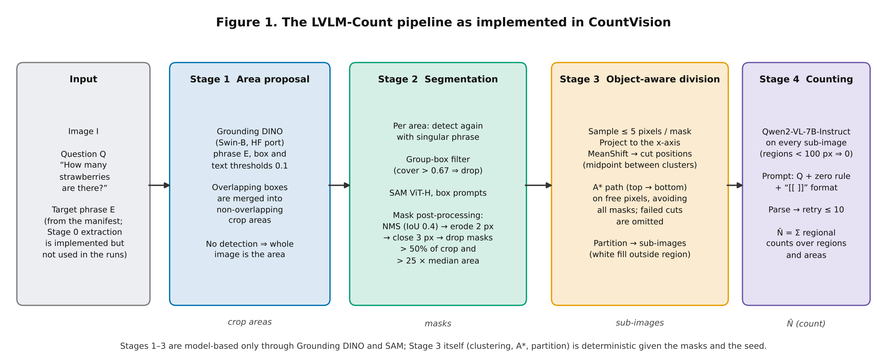
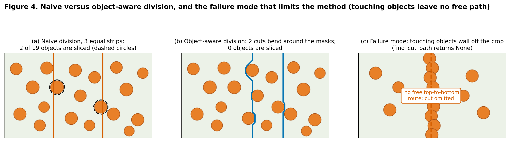
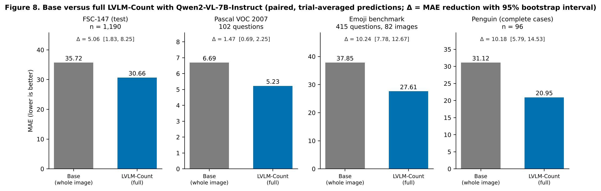
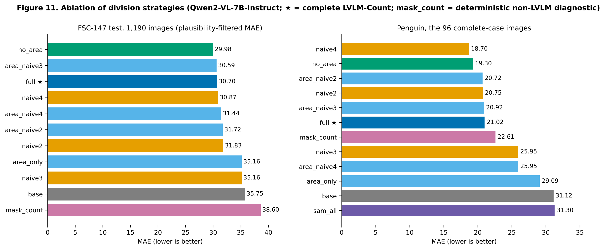

# CountVision: Object-Aware Image Division for Visual Counting

**A reproducibility study of LVLM-Count with Qwen2-VL-7B-Instruct, Grounding DINO and SAM**

CountVision is a training-free reimplementation of **LVLM-Count** (Qharabagh, Ghofrani and Fountoulakis, 2024). Instead of asking a vision-language model to count a crowded image in one pass, the method locates the target objects, cuts the image along paths that avoid the detected object masks, counts each region separately, and sums the regional counts. This repository evaluates the method with one open backbone against whole-image counting and ten simpler variants.

> **Full documentation:** [DOCUMENTATION.md](DOCUMENTATION.md) · **Scientific report:** [report/countvision.pdf](report/countvision.pdf) · **Design decisions:** [docs/decisions.md](docs/decisions.md)

---

## Abstract

Large vision-language models (LVLMs) tend to undercount scenes with many small objects. LVLM-Count addresses this by dividing the image into regions with fewer objects, without cutting through objects. We reimplement the method with Qwen2-VL-7B-Instruct, Grounding DINO (Swin-B) and SAM (ViT-H), and evaluate it on **FSC-147**, **Pascal VOC 2007**, the **Emoji benchmark**, **Penguin** and **Synthetic Circles**. Compared with whole-image counting, the full method lowers the mean absolute error on all four comparison benchmarks, with 95% paired bootstrap intervals that exclude zero. The evidence is nevertheless qualified: RMSE rises on FSC-147, and simpler division variants match or beat the full method on FSC-147 and Penguin.

---

## 1. Method at a glance



| Stage | What happens |
|---|---|
| 1. Area proposal | Grounding DINO (Swin-B) proposes regions that contain the target phrase. |
| 2. Segmentation | Phrase-guided boxes, filtered for "group" boxes, prompt SAM ViT-H; masks are de-duplicated, eroded, closed and screened for oversize. |
| 3. Object-aware division | Sampled mask pixels are clustered along the x-axis (mean shift). A\* search draws a top-to-bottom cut between clusters that never crosses a mask. |
| 4. Counting | Qwen2-VL-7B-Instruct counts each sub-image; the counts are summed. |

Object-aware cuts bend around objects, whereas equal strips can slice them:



A step-by-step example is in [DOCUMENTATION.md, Section 4](DOCUMENTATION.md#4-worked-example-of-object-aware-division). The failure mode in panel (c), touching objects that leave no free path, is the method's main limitation.

---

## 2. Benchmarks

| Benchmark (original name) | Size used | Role |
|---|---|---|
| **FSC-147** (Few-Shot Counting-147; Ranjan et al., 2021) | 1,190 test images | Main benchmark and ablation |
| **Pascal VOC 2007** (Everingham et al., 2010) | 102 counting questions (authors' list) | Small-count benchmark |
| **Emoji benchmark** (released with LVLM-Count) | 415 questions, 82 images | Dense counts (30–50) |
| **Penguin** (Arteta et al., 2016, *Counting in the Wild*) | 100 sampled images; 96 complete cases | Dense, natural scenes |
| **Synthetic Circles** (generated) | 220 images | Whole-image baseline only |

---

## 3. Main results

Paired MAE of whole-image counting (`base`) versus the full method, Qwen2-VL-7B-Instruct, lower is better:

| Benchmark | `base` | `full` | Δ MAE | 95% bootstrap CI |
|---|---|---|---|---|
| FSC-147 | 35.72 | **30.66** | 5.06 | [1.83, 8.25] |
| Pascal VOC 2007 | 6.69 | **5.23** | 1.47 | [0.69, 2.25] |
| Emoji benchmark | 37.85 | **27.61** | 10.24 | [7.78, 12.67] |
| Penguin (96 complete cases) | 31.12 | **20.95** | 10.18 | [5.79, 14.53] |



### Ablation of division strategies



### What the results do and do not show

- **Dividing the image helps on average** on every benchmark where both methods were run.
- **The full method is not the best variant.** `no_area` (29.98) and `area_naive3` (30.59) have slightly lower MAE than `full` (30.70) on FSC-147, and `naive4` (18.70) and `no_area` (19.30) beat `full` (21.02) on Penguin.
- **Squared error gets worse on FSC-147:** RMSE rises from 131.74 to 143.50, while MAE and median error fall.
- **Answer handling matters.** A post hoc plausibility rule (single answers above 10,000 count as 0) removes 22 absurd answers across FSC-147 runs; without it, the whole-image MAE would be 553,931. Both filtered and unfiltered values are reported.

Further figures (tolerance accuracy, paired forest plot, error metrics, format compliance, cut-failure diagnostic) are in [DOCUMENTATION.md, Section 7](DOCUMENTATION.md#7-results).

---

## 4. Limitations

- One backbone (Qwen2-VL-7B-Instruct, near-greedy decoding); the paper's backbones are **not** reproduced, so absolute numbers are not comparable with the paper's tables.
- The plausibility rule was chosen after inspecting test outputs; mask filters were tuned on 30 validation images.
- Four Penguin images failed preprocessing in the full pipeline (CUDA allocation errors), so Penguin comparisons use the 96 complete cases.
- Only 43 of the 102 released Pascal VOC 2007 labels match the raw VOC count; no independent audit was done.
- Synthetic Circles is a baseline only. Bootstrap intervals exist for base-versus-full, not for the ablation.
- **Known issue:** `LVLMCount.run()` in `src/lvlm_count/pipeline.py` raises `NameError` (`cfg` should be `self.cfg`). Reported results are unaffected because evaluation uses cached `divide()` outputs and a separate job worker. See [Section 10](DOCUMENTATION.md#10-known-issue-in-the-released-code).

---

## 5. Quick start

CPU-only checks (no GPU, weights or datasets):

```sh
python3 -m venv .venv && source .venv/bin/activate
python -m pip install -r requirements.txt
make test-cpu PY_PAPER=python                 # unit tests for division, parsing and metrics
make paper PY_PAPER=python                    # rebuild the PDF report from checked-in CSVs
python scripts/figures/doc_figures.py         # regenerate the documentation figures into docs/figures
```

Full reproduction requires the datasets, model checkpoints (Grounding DINO Swin-B, SAM ViT-H, Qwen2-VL-7B-Instruct) and GPUs. See the `Makefile` targets `benchmarks`, `precompute`, `jobs`, `run` and `aggregate`, the environment lockfiles (`requirements.detect.lock`, `requirements.lvlm.lock`) and [DOCUMENTATION.md, Section 11](DOCUMENTATION.md#11-reproducibility). All randomness is seeded with 1234. Key parameters are in [`configs/lvlm_count.yaml`](configs/lvlm_count.yaml).

---

## 6. Repository layout

```
configs/lvlm_count.yaml    fixed experiment parameters
src/lvlm_count/            grounding, segmentation, division, counting, metrics, pipeline
scripts/                   benchmark builders, job workers, aggregation; figures/doc_figures.py
tests/                     division, parser/metric and benchmark tests
docs/                      decisions.md and figures/ (documentation figures)
report/                    manuscript, build script and PDF report
results/tables/            aggregated results (CSV, JSON, Markdown)
```

The repository does not include datasets, model weights, raw trial logs or benchmark imagery.

---

## 7. Citation and rights

Please cite this software together with the original method paper (see [CITATION.cff](CITATION.cff)):

> M. F. Qharabagh, M. Ghofrani and K. Fountoulakis. *LVLM-Count: Enhancing the Counting Ability of Large Vision-Language Models.* arXiv:2412.00686, 2024.

All rights are reserved by the respective copyright holders; **no open-source licence has been assigned** to this release (see [LICENSE](LICENSE)).

---

## References

1. Qharabagh, Ghofrani and Fountoulakis. LVLM-Count. arXiv:2412.00686, 2024.
2. Ranjan et al. Learning To Count Everything (FSC-147). CVPR, 2021.
3. Wang et al. Qwen2-VL. arXiv:2409.12191, 2024.
4. Liu et al. Grounding DINO. ECCV, 2024.
5. Kirillov et al. Segment Anything. ICCV, 2023.
6. Everingham et al. The PASCAL Visual Object Classes (VOC) Challenge. IJCV, 2010.
7. Arteta, Lempitsky and Zisserman. Counting in the Wild (Penguin). ECCV, 2016.
